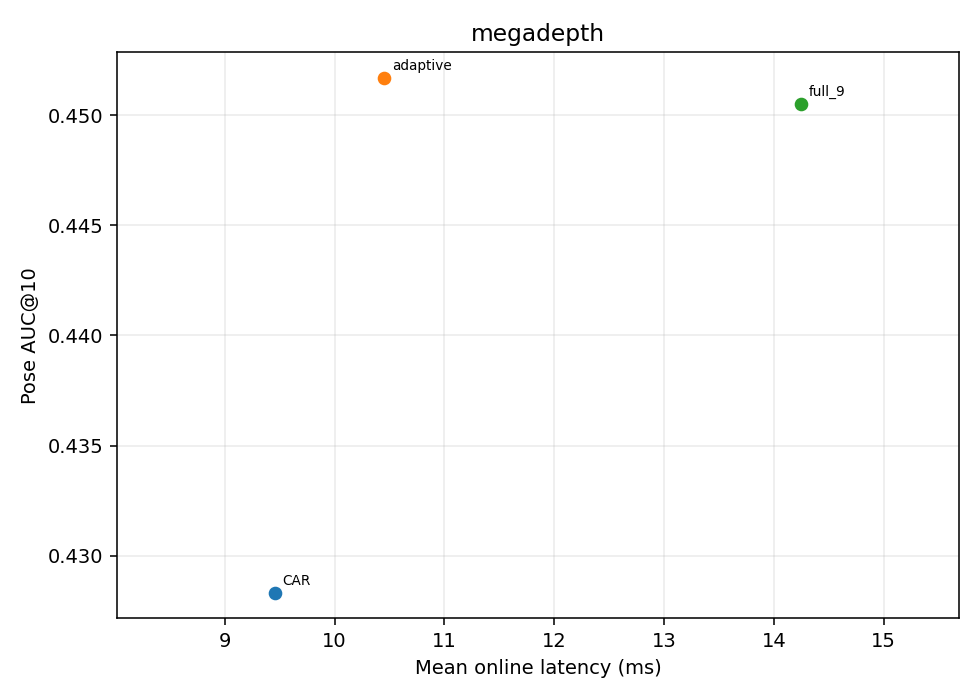
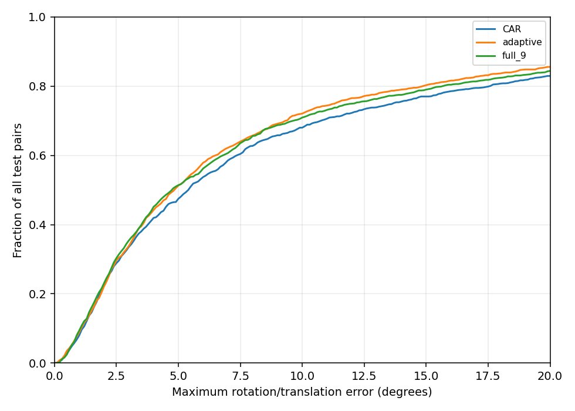
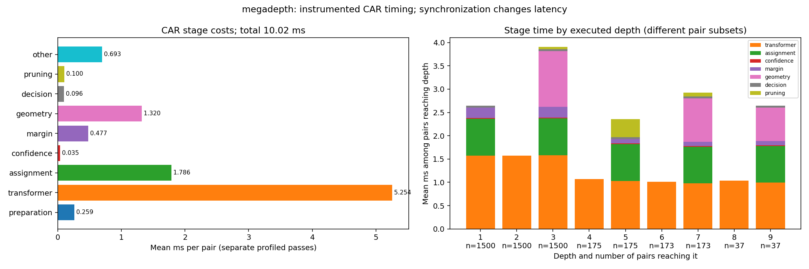

# CARLightGlue

Experiments in controlling the inference cost of pretrained LightGlue for local
feature matching. This research fork of [LightGlue](https://github.com/cvg/LightGlue)
provides **rule-based CAR**, optional intermediate keypoint pruning, and
reproducible evaluation on HPatches and MegaDepth-1500.

All experimental matchers use frozen pretrained weights. No controller training
or fine-tuning is required. Standard LightGlue behavior remains the default.

## Contents

- [Methods](#methods)
- [Saved results and plots](#saved-megadepth-1500-results)
- [Installation](#installation) and [quick start](#quick-start)
- [Python API](#python-api)
- [Theory and evaluation](#theory-and-evaluation)
- [Command-line manual](#command-line-manual)
- [Attribution](#attribution) and [license](#license)

## Methods

| Method | Transformer layers | Stopping and pruning |
|---|---|---|
| Full LightGlue (`full_9`) | Nine distinct pretrained layers | Built-in adaptivity disabled |
| Adaptive LightGlue (`adaptive`) | Original pretrained layers | Original confidence-based depth/width adaptation |
| CAR (`CAR`) | Original distinct pretrained layers | Fixed matching/geometry rules; optional matchability pruning |

CAR examines matching confidence, similarity margin, match-count progress, and
estimated geometric consistency at checkpoints. It accepts matches, continues,
or withholds matches when evidence remains insufficient. It does not guarantee
better accuracy or lower latency than adaptive LightGlue: both must be measured.

## Saved MegaDepth-1500 results

These are **previously recorded runs**, not new measurements of this cleanup.
Both evaluated 1,500 pairs on an NVIDIA GeForce RTX 3060 Laptop GPU using
SuperPoint (512 keypoints, resize 640), PyTorch 2.9.1+cu128, one warmup, and
three timing repetitions. Flash attention and mixed precision were disabled.
Latency is the mean of per-pair median matcher times; it excludes SuperPoint,
image I/O, feature transfers, and downstream pose estimation.

| Run | Method | Mean layers | Latency (ms) ↓ | Epi. precision (%) ↑ | AUC@5° (%) ↑ | AUC@10° (%) ↑ | AUC@20° (%) ↑ |
|---|---|---:|---:|---:|---:|---:|---:|
| Unpruned run | CAR | 3.51 | 9.88 | 92.63 | 25.62 | 42.89 | 59.95 |
| Unpruned run | adaptive | 5.79 | 11.00 | 97.01 | 26.98 | 45.17 | 62.58 |
| Unpruned run | full_9 | 9.00 | 14.79 | 97.27 | 27.59 | 45.05 | 61.86 |
| Pruned run | CAR | 3.51 | 9.46 | 92.55 | 25.92 | 42.83 | 59.71 |
| Pruned run | adaptive | 5.79 | 10.45 | 97.01 | 26.98 | 45.17 | 62.58 |
| Pruned run | full_9 | 9.00 | 14.25 | 97.27 | 27.59 | 45.05 | 61.86 |

In the pruned run, CAR used **9.46 ms versus adaptive LightGlue's 10.45 ms**
(about 9.5% less matcher time), while AUC@20° fell from **62.58% to 59.71%**.
CAR withheld 26 pairs as unresolved; it rejected none early. Failed and withheld
poses remain in the denominator. These results show a speed–accuracy trade-off,
not accuracy-equivalent acceleration. Pruning used threshold 0.1, a floor of
64 points per image, and started at depth 3.

The two runs have different measured baseline latencies. Their raw CAR latency
difference alone does not isolate the effect of pruning. Epipolar precision uses
squared symmetric error at $10^{-4}$ in normalized camera coordinates; pose AUC
uses OpenCV essential-matrix RANSAC with a 1-pixel threshold. This is not an
identical protocol to published PoseLib benchmark numbers.

### Accuracy and latency



### Relative-pose recall



### CAR component timing



The component plot comes from separate synchronized profiling passes. Its
10.02 ms total includes instrumentation overhead and must not replace the
9.46 ms normal latency. Later-depth bars summarize only pairs reaching that depth.

Archived measurements and provenance:

- Unpruned: [summary](assets/results/car_1500_01/summary.csv), [report](assets/results/car_1500_01/REPORT.md), [settings](assets/results/car_1500_01/manifest.json).
- Pruned: [summary](assets/results/car_pruned_01/summary.csv), [report](assets/results/car_pruned_01/REPORT.md), [settings](assets/results/car_pruned_01/manifest.json), [component times](assets/results/car_pruned_01/profile_summary.csv).

The selected snapshots and plots are committed under `assets/results/`. Full
local run directories under `results/` remain excluded from Git.

## Installation

Use Python 3.10+ and PyTorch 2.x for the experiment scripts. Install a
CUDA-compatible PyTorch build if using an NVIDIA GPU.

```bash
git clone https://github.com/TahaAbd13/CARLightGlue.git
cd CARLightGlue
python -m pip install -v -e .
```

The package is named `carlightglue`; Python imports remain `lightglue` for
compatibility with the original API.

Pretrained models download on first use if not cached. Datasets, caches, and
full local results are excluded from Git; selected result snapshots are in assets. Run experiment modules from the repository root.

## Quick start

After downloading and extracting the **HPatches full-image sequences** under
`data/hpatches-sequences-release`, create a pair manifest:

```bash
python -u -m experiments.car_prepare \
  --data data/hpatches-sequences-release \
  --output data/hpatches_pairs.json \
  --seed 17 --verbose
```

Evaluate CAR and the two original LightGlue baselines:

```bash
python -u -m experiments.car_evaluate \
  --manifest data/hpatches_pairs.json --partition test \
  --output results/HPatches/car_01 \
  --device cuda --max-keypoints 512 --resize 640 \
  --warmup 1 --timing-repeats 3 \
  --profile --profile-repeats 3 --verbose
```

Use `--device cpu` if CUDA is unavailable. Add `--prune-keypoints` to enable
CAR pruning. Output directories must be new or empty. Open the generated
`REPORT.md` for accuracy, decisions, and latency; component timing plots come
from separate instrumented passes.

## Python API

```python
from lightglue import LightGlue
from lightglue.car_match import CAR, CARConfig

backbone = LightGlue(
    features="superpoint", depth_confidence=-1, width_confidence=-1,
    flash=False,
).eval().cuda()
matcher = CAR(backbone, CARConfig(geometry="homography", pruning=True))
# features0/features1 are SuperPoint.extract outputs on the same device.
# prediction = matcher({"image0": features0, "image1": features1})
```

CAR currently supports one image pair per call and an uncompiled backbone.
Use `geometry="fundamental"` for general wide-baseline scenes. The original
`LightGlue(features="superpoint")` interface remains available.

## Development

```bash
python -m unittest discover -s tests -v
```

The tests use synthetic inputs; they do not download datasets or run benchmarks.
Experiment code is in `experiments/`; CAR and profiling are in
`lightglue/car_match.py` and `lightglue/profiling.py`. Results are written under
`results/HPatches/` and `results/Megadepth/` and are generated locally.

## Theory and evaluation

### Matching pipeline

A **keypoint** is a detected image location. Its **descriptor** encodes local
appearance. A **match** is a proposed pair of keypoints, one from each image;
it can be correct or incorrect.

A Transformer layer updates descriptors using self-attention within each image
and cross-attention between images. An assignment head converts the updated
descriptors into matching scores, combining directional softmax scores and
predicted matchability. Filtering keeps mutual best correspondences above the
matching-score threshold.

CAR uses the original sequence of distinct Transformer layers. At decision
checkpoints (by default 1, 3, 5, 7, 9), it applies that layer's own pretrained
assignment head, extracts evidence, and chooses an action. Updated descriptors
feed the next layer if computation continues. The configured final depth is
always a decision checkpoint.

CAR differs from original adaptive LightGlue:

- **Original adaptive LightGlue** uses learned token confidence for depth stopping
  and matchability/confidence for width pruning; it does not use CAR's geometry rules.

CAR requires batch size one and an uncompiled backbone. Built-in LightGlue
adaptivity is disabled inside CAR so the stopping mechanisms do not conflict.

### Current matching evidence

Let $M$ be the number of filtered matches, and $K_0,K_1$ the original keypoint
counts. Each checkpoint records eight features:

| Feature | Definition and role |
|---|---|
| `log_matches` | $\log(1+M)$; represents the match count |
| `match_fraction` | $f=M/\max(\min(K_0,K_1),1)$; measures matching support |
| `score_mean` | Mean score of current filtered matches; zero if empty |
| `similarity_margin` | Mean gap between the best and second-best descriptor similarity |
| `delta_match_fraction` | Current $f$ minus the previous checkpoint's $f$; zero initially |
| `geometry_enabled` | Whether a geometric model is configured |
| `geometry_available` | Whether the latest geometric fit succeeded |
| `geometry_inlier_fraction` | Fraction of sampled correspondences classified as inliers |

These are prediction summaries, not input image descriptors. Ground-truth
homographies, poses, and correctness labels never enter the online controller.
There is no coverage rule.

#### Mean confidence

For filtered match scores $c_1,\ldots,c_M$:

$$
\bar c=\frac{1}{M}\sum_{i=1}^{M}c_i
$$

For three matches with scores 0.8, 0.6, and 0.4, the mean is 0.6. This passes
the mean-confidence threshold of 0.3, but all other acceptance conditions must
also pass. A high mean score does not prove that matches are correct.

#### Similarity margin

For each row and column of the current descriptor-similarity matrix, subtract
the second-largest entry from the largest. Average the gaps across both image
directions, clipping individual gaps to at most 20. The result is $\bar m$.
If either image has fewer than two active points, the margin is zero.

A larger gap suggests a less ambiguous candidate. The margin is computed from
similarities, not from the mean filtered match score. Its top-two reductions
inspect the active similarity matrix and may cost more than scalar rules.

#### Geometric agreement

The CLI uses a homography for HPatches and a fundamental matrix for MegaDepth.
By default, fits occur at reached checkpoints 3, 7, and 9. Between fits, the
controller reuses the latest geometric evidence; before the first fit it is
unavailable. The Python API defaults to `geometry="none"` unless configured.

The fitter uses at most 256 correspondences, selected at evenly spaced positions
in the source-index-ordered match list. OpenCV uses USAC_MAGSAC when available,
otherwise RANSAC, with a 3-pixel threshold and at most 500 iterations. A fit needs
at least four points for a homography or eight for the fundamental matrix.
Failed or invalid fits are unavailable.

$$
g=\frac{\text{number of inliers in the fitted subset}}
        {\text{number of correspondences in the fitted subset}}
$$

This is estimated consistency, not ground-truth accuracy. Repetitive structures,
degenerate configurations, or an unsuitable geometric model can produce misleading
evidence. Geometry runs on the CPU and includes transfers from GPU when needed.

### Fixed decision scores

Define the basic acceptance condition:

$$
A_{\mathrm{basic}}=
(M\geq20)\land(\bar c\geq0.3)\land
(\bar m\geq0.1).
$$

When geometry is enabled, add its conditions:

$$
A=A_{\mathrm{basic}}\land(\text{geometry available})\land(g\geq0.6).
$$

Otherwise $A=A_{\mathrm{basic}}$. CAR produces two fixed heuristic scores:

$$
U=\begin{cases}
0.99 & \text{if }A,\\
0.01 & \text{if not }A\text{ and }f<0.02,\\
0.5 & \text{otherwise},
\end{cases}
\qquad
R=\begin{cases}
0.01 & \text{if }f<0.02\text{ and }\Delta f\leq0,\\
0.8 & \text{otherwise}.
\end{cases}
$$

These appear in output as `usable_score` and `recovery_score`. They are
**not learned or calibrated probabilities**. In particular, U = 0.99 is a rule
label, not a claim of 99% correctness. The recovery score uses only match fraction
and its change; it does not predict the future using a neural network.

Notice that poor geometry or low confidence alone does not trigger early
rejection. A pair with many matches can keep failing acceptance and eventually
become UNRESOLVED.

### Stopping policy

The policy checks the following conditions **in order**:

1. **ACCEPT:** minimum depth reached, enough matches, and $U\geq0.95$.
2. **UNRESOLVED:** maximum depth reached without acceptance.
3. **REJECT:** from layer 5 onward, both $U\leq0.1$ and $R\leq0.05$
   hold at two consecutive eligible decision checkpoints. A checkpoint that
   fails these conditions resets the rejection count.
4. **CONTINUE:** none of the above applies.

Minimum depth defaults to 1 and maximum depth to 9. The earliest default rejection
is layer 7, following low evidence at layers 5 and 7. At the maximum depth,
acceptance is checked first; otherwise the result is UNRESOLVED, not REJECT.

| Action | Interpretation | Returned correspondences |
|---|---|---|
| ACCEPT | Current predictions satisfy the fixed rules | All currently filtered matches |
| CONTINUE | More computation is allowed | No final output yet |
| REJECT | Stop early after persistently weak, non-improving match-count evidence | Empty |
| UNRESOLVED | The available layers ended without passing acceptance | Empty |

Acceptance returns the current filtered match list, **not only the geometric
inliers**. Geometry contributes evidence to the stopping decision; it does not
replace the output with the sampled inlier subset.

Rejected and unresolved both withhold matches, but rejection is an early policy
decision and unresolved means the budget expired. Neither proves that the images
show unrelated scenes or that every current match is wrong.


### Optional keypoint pruning

Pruning is disabled by default. When enabled, it runs after CONTINUE at eligible
checkpoints, starting at depth 3, and never after the final depth. It uses the
assignment head's pretrained per-keypoint **matchability**, not the mean match
confidence or a ground-truth correctness label.

If the unmatched entry is $u_i=\log(1-p_i)$, recover matchability as:

$$
p_i=1-\exp(u_i)
$$

For each image, retain points with $p_i\geq\tau$, plus enough highest-scoring
points to satisfy a retention floor. Defaults are $\tau=0.1$ and 64 points per
image, limited by the active count. Nonfinite scores are conservatively retained.

For example, if only 20 of 512 active points pass the threshold, the best 64 are
kept. If 180 pass, all 180 are kept. A point removed at one checkpoint cannot
return at a later layer.

Descriptors and positional encodings are compacted together in stable original
order. Output matches are mapped back to the **original keypoint indices**;
removed points have unmatched outputs and zero scores. Match fractions retain
the original-count denominator, while similarity margins use the active matrix.

Pruning reduces the size of later attention and assignment computations, but it
can remove useful points and introduces its own overhead. Compare pruned and
unpruned runs with identical initial detections and settings. Diagnostic
`collect=True` traces deliberately remain unpruned and do not follow early stops.

### Timing and profiling

Normal matcher latency includes preprocessing inside the matcher, executed
layers, assignments, controller features, geometry, decisions, and optional
pruning. It excludes image loading, feature extraction, ground-truth evaluation,
and plotting. Timings synchronize the device at measurement boundaries, use
warmups, and take a median across repetitions for each pair before averaging pairs.

Component profiling runs in **separate instrumented passes**. Synchronization at
stage boundaries changes execution time, so component totals are not substitutes
for normal latency.

| Stage | Work measured |
|---|---|
| `preparation` | Matcher input preparation and positional encodings |
| `transformer` | Descriptor refinement through self- and cross-attention |
| `assignment` | Matching head, filtering, and prediction construction |
| `confidence` | Mean filtered-match confidence |
| `margin` | Top-two similarity reductions |
| `geometry` | Point transfers and robust geometric fitting |
| `decision` | Fixed scores and stopping policy |
| `pruning` | Selecting retained points and compacting tensors |
| `other` | Residual bookkeeping and profiler overhead |

Skipped stages contribute zero to per-pair summaries. Depth plots average only
pairs that reached the indicated depth. Geometry and matrix reductions can cost
more than the scalar decisions; use measured profiles to identify the bottleneck
on a particular device and feature budget.

### Evaluation

The three default configurations are `full_9` (all nine layers, no built-in adaptivity),
`adaptive` (original LightGlue stopping/pruning), and `CAR` (our fixed rules).
They receive identical cached SuperPoint keypoints and descriptors. Current CLI
defaults use 512 keypoints, a 640-pixel extraction long edge, flash attention off,
and full precision.

#### Matching accuracy on HPatches

Ground-truth homographies are used **only by the evaluator**. At thresholds
$t=1,3,5$ original-image pixels, a correspondence is correct when its target
point is close enough to the projected source point. Projections must be finite
and inside the target image.

For pair i, let $C_i(t)$ be correct matches, $M_i$ returned matches, and
$D_i(t)$ source detections whose projected positions have at least one target
detection within t pixels.

| Metric | Calculation |
|---|---|
| Pooled precision@t | $\sum_i C_i(t)/\sum_i M_i$ |
| Recall@t | $\sum_i C_i(t)/\sum_i D_i(t)$ |
| MMA@t | Mean over pairs of $C_i(t)/M_i$ |
| Correct matches per pair | $\sum_i C_i(t)$ divided by the number of pairs |

Empty predictions contribute zero to pair MMA; pooled ratios with zero
denominators are zero. Recall is directional and conditional on the fixed
keypoint detections. It is different from CAR's match fraction.

For example, pair precisions 90/100 and 5/10 give pooled precision 95/110 = 86.4%,
but MMA = (0.9 + 0.5)/2 = 70%. MMA weights pairs equally.

Illumination and viewpoint results are separate. Assumed-negative distractors are
excluded from matching accuracy but included in combined timing and decision
statistics. Rejected/unresolved positive pairs remain in accuracy denominators.

#### Decision quality and MegaDepth

For offline auditing, a proposal is usable when it has at least 20 **correct**
matches and precision at least 0.8. This ground-truth criterion differs from the
runtime rules. HPatches uses 3 pixels; MegaDepth uses squared symmetric epipolar
error at 1e-4 in normalized camera coordinates.

False acceptance means accepting a proposal that fails that criterion; its
reported fraction divides by accepted proposals. False rejection means REJECT
on a pair usable at some layer within the budget; its fraction divides by those
oracle-usable pairs. An oracle is an offline ground-truth diagnostic, never a
runtime input. UNRESOLVED is reported separately, and usable-pair retention shows
losses caused by withholding outputs. Baselines count as accepted for this audit
when they return at least 20 matches; accuracy still uses all their matches.

MegaDepth also reports pose AUC at 5°, 10°, and 20°. Pose error is the larger of
rotation error and sign-invariant translation-direction error. Failed or withheld
poses stay in the denominator with infinite error. Pose estimation uses OpenCV
essential-matrix RANSAC with a 1-pixel threshold; these settings differ from some
published benchmark protocols.

A useful CAR configuration must balance **accuracy, usable-pair retention, and
normal latency**. Fewer layers or high precision on a small accepted subset alone
do not establish an improvement.


### Interpretation and limitations

CAR's thresholds are heuristics, not calibrated probabilities or a guarantee
of correctness. Low overlap can produce few matches even for related images;
poor geometry can prevent acceptance on valid pairs. ACCEPT returns the entire
filtered match list, not just geometric inliers. REJECT and UNRESOLVED withhold
matches, so report unconditional accuracy and usable-pair retention alongside speed.

Select thresholds on validation data before testing. HPatches partitioning groups
identical image contents together and includes assumed cross-sequence distractors;
these negative labels are not independently verified. MegaDepth-1500 is used for
evaluation. Different feature budgets, devices, geometric estimators, and timing
protocols can change conclusions.

A reduction in executed layers alone is not evidence of lower latency. Additional
assignment and geometric checks may outweigh saved Transformer computation.
Similarly, high precision on a small accepted subset does not establish improved
matching performance. The method's benefit must be assessed from accuracy, recall,
pose quality, retention, and total latency together.

Generated reports describe their own run settings. Historical results may use
older rules or profiling stages and should not be treated as measurements of the
current implementation. No accuracy or speed improvement is guaranteed by this code.

## Command-line manual

Run commands from the cloned repository root after installation. All evaluation
examples enable `--verbose`; `-u` prints progress without buffering. Use
`--device cpu` when CUDA is unavailable. Model weights download on first use.

### Choose the operation

| What you want | Command module | Runs inference? |
|---|---|---|
| Create an HPatches pair manifest | `experiments.car_prepare` | No |
| Download/verify MegaDepth files | `experiments.download_megadepth` | No |
| Evaluate CAR and the two LightGlue baselines | `experiments.car_evaluate` | Yes |
| Rebuild tables and plots from saved measurements | `experiments.car_report` | No |
| Check implementation with synthetic tests | `unittest` | Small synthetic tests only |

If your dataset and pair manifest already exist, skip preparation and go to
[Run CAR evaluation](#run-car-evaluation). **Evaluation requires a new or empty output directory.** Change the
run name when repeating an experiment; the code does not overwrite or resume a
nonempty evaluation directory.

### Prepare the inputs

#### HPatches: create a pair manifest if needed

Two inputs are needed for evaluation:

1. The original full-image sequences, not cropped descriptor patches.
2. A JSON pair manifest listing image paths, partitions, and ground-truth
   homographies for positive pairs.

Expected image layout:

```text
data/hpatches-sequences-release/
  i_autannes/
    1.ppm ... 6.ppm
    H_1_2 ... H_1_6
  v_.../
```

Datasets and manifests are not included in Git. After extracting HPatches,
create the manifest used by the commands below:

```bash
python -u -m experiments.car_prepare \
  --data data/hpatches-sequences-release \
  --output data/hpatches_pairs.json \
  --seed 17 \
  --verbose
```

| Option | Default | Input and effect |
|---|---|---|
| `--data` | `data/hpatches-sequences-release` | Directory containing the full-image sequence folders |
| `--output` | `data/hpatches_pairs.json` | JSON file to create; must not already exist |
| `--seed` | `17` | Integer controlling the reproducible partition/pair construction |
| `--verbose` | Off | Print scanning, partition counts, and output information |

This command checks image-content separation between partitions and creates
positive pairs plus assumed cross-sequence distractors. It does not run matching.
Distractors are not independently verified as unrelated.

If you choose a different manifest filename, pass that path with `--manifest`. Manifests contain absolute image paths; regenerate them if the data
moves to a different location or machine. Full-image data is linked from the
[official HPatches repository](https://github.com/hpatches/hpatches-dataset).

#### MegaDepth: download or verify files if needed

```bash
python -u -m experiments.download_megadepth \
  --destination data \
  --workers 16 \
  --verbose
```

| Option | Default | Input and effect |
|---|---|---|
| `--destination` | `data` | Parent extraction directory; the archive creates `megadepth1500` beneath it |
| `--workers` | `16` | Number of concurrent download/check workers; allowed range 1–32 |
| `--verbose` | Off | Print progress after every verified file |

The command downloads official images and camera/pair metadata using HTTP byte
ranges, verifies ZIP checksums, reuses valid existing files, and omits depth maps.
It requires network access and a server that supports range requests.

Evaluation receives the dataset directory containing `pairs.txt`, `views.txt`,
and images, normally `data/megadepth1500`. It does not take `pairs.txt` alone as
its `--megadepth` argument. Skip downloading if those files are already present.

### Run CAR evaluation

These commands perform evaluation when **you execute them**. Pick the dataset
and pruning mode you want. Example run names must be changed if already used.

#### Quick HPatches check: six pairs

```bash
python -u -m experiments.car_evaluate \
  --manifest data/hpatches_pairs.json \
  --partition test \
  --output results/HPatches/quick_check_01 \
  --device cuda --limit 6 \
  --warmup 1 --timing-repeats 1 \
  --profile --profile-repeats 1 \
  --verbose
```

This selects the first six pairs in the chosen partition. It checks that the
pipeline and reports work; it is not a representative accuracy benchmark.
Pruning is disabled because `--prune-keypoints` is absent.

#### HPatches test partition: pruning off

```bash
python -u -m experiments.car_evaluate \
  --manifest data/hpatches_pairs.json \
  --partition test \
  --output results/HPatches/car_unpruned_01 \
  --device cuda --max-keypoints 512 --resize 640 \
  --warmup 1 --timing-repeats 3 \
  --profile --profile-repeats 3 \
  --visualize-per-split 2 \
  --verbose
```

With the preserved manifest, the test partition contains 100 positive pairs and
100 assumed-negative pairs. Accuracy is reported separately for illumination and
viewpoint changes. CAR fits homographies for its geometric checks.

To include all 116 sequences, change `--partition test` to `--partition all` and
choose a different output directory. That includes 580 positive and 580 distractor
pairs. Use `--partition validation` when selecting thresholds. Aggregates from
`all` and `test` represent different pair populations.

#### HPatches test partition: pruning on

```bash
python -u -m experiments.car_evaluate \
  --manifest data/hpatches_pairs.json \
  --partition test \
  --output results/HPatches/car_pruned_01 \
  --device cuda --max-keypoints 512 --resize 640 \
  --prune-keypoints --pruning-threshold 0.1 \
  --pruning-min-keypoints 64 --pruning-start-depth 3 \
  --warmup 1 --timing-repeats 3 \
  --profile --profile-repeats 3 \
  --visualize-per-split 2 \
  --verbose
```

This uses the same data and feature settings as the preceding command. Only CAR
gets the additional pruning option. Compare their saved CAR rows to assess the
change; both runs also include the original baselines.

#### MegaDepth-1500: pruning off

```bash
python -u -m experiments.car_evaluate \
  --megadepth data/megadepth1500 \
  --output results/Megadepth/car_unpruned_01 \
  --device cuda --max-keypoints 512 --resize 640 \
  --warmup 1 --timing-repeats 3 \
  --profile --profile-repeats 3 \
  --verbose
```

This evaluates all 1,500 listed pairs. CAR uses a fitted fundamental matrix.
Reports include epipolar precision and relative-pose AUC at 5°, 10°, and 20°.
HPatches `--manifest` and `--partition` settings do not select MegaDepth pairs.

#### MegaDepth-1500: pruning on

```bash
python -u -m experiments.car_evaluate \
  --megadepth data/megadepth1500 \
  --output results/Megadepth/car_pruned_01 \
  --device cuda --max-keypoints 512 --resize 640 \
  --prune-keypoints --pruning-threshold 0.1 \
  --pruning-min-keypoints 64 --pruning-start-depth 3 \
  --warmup 1 --timing-repeats 3 \
  --profile --profile-repeats 3 \
  --verbose
```

Pruning can reduce subsequent attention and assignment work, but its own overhead
and the loss of useful points can affect latency and accuracy. The defaults are
experimental settings, not a guarantee of improvement.

### Evaluation options: inputs, defaults, and effects

These options belong to `experiments.car_evaluate`. Other scripts have their own
options described in their sections.

#### Dataset and output

| Option | Default | Meaning |
|---|---|---|
| `--manifest PATH` | `data/hpatches_pairs.json` | HPatches input JSON pair manifest |
| `--partition NAME` | `test` | HPatches subset: `test`, `validation`, `calibration`, or `all` |
| `--megadepth PATH` | Unset | MegaDepth dataset directory; selects MegaDepth instead of HPatches |
| `--output PATH` | **Required** | New or empty directory where this run's outputs are written |
| `--limit N` | `0` | First N selected pairs; 0 means every selected pair |
| `--cache PATH` | `data/car_features` | Shared cache of SuperPoint features; reused across configurations/runs |

`--limit` counts image pairs, not images or sequences. Input manifests are not
result manifests: `--manifest` expects the HPatches pair list, not a run's
`manifest.json`. Changing image contents, extraction settings, or relevant cache
metadata produces different feature-cache keys.

#### Device and feature extraction

| Option | Default | Meaning |
|---|---|---|
| `--device DEVICE` | `cpu` | Compute device, for example `cuda`, `cuda:0`, or `cpu` |
| `--max-keypoints N` | `512` | Positive upper limit on SuperPoint detections per image |
| `--resize N` | `640` | Extraction long-edge setting; 0 uses original resolution |

All configurations in a run receive identical features. Geometric evaluation
uses original-image coordinates. More keypoints generally increase matching work;
changing extraction resolution can also change detections and accuracy. The CAR
CLI uses full precision and flash attention off; it exposes no flash flag.

#### CAR stopping policy

| Option | Default | Meaning |
|---|---|---|
| `--min-depth N` | `1` | Earliest CAR acceptance depth |
| `--max-depth N` | `9` | CAR layer budget; require `1 <= min-depth <= max-depth <= 9` |
| `--accept-threshold X` | `0.95` | Accept when CAR's usability score reaches this value and the minimum-match/depth gates pass |
| `--reject-usable-threshold X` | `0.1` | Maximum usability score considered low for early rejection |
| `--reject-recoverable-threshold X` | `0.05` | Maximum recovery score considered low for early rejection |

Thresholds must be in [0, 1]. These scores are fixed heuristic values, not learned
probabilities. Changing acceptance from 0.95 to 0.9 does not change which of
0.99, 0.5, or 0.01 passes. This option is **not** the per-match filtering threshold
and does not directly set the mean-confidence rule.

Default decision checkpoints are 1, 3, 5, 7, and 9, plus the final configured depth.
Rejection starts at depth 5 and requires two consecutive low checkpoints.
Geometry runs at 3, 7, and 9 when reached; with geometry enabled there is no
acceptance before its first check. Reducing the budget below 3 therefore prevents
acceptance with the CLI's default geometry schedule.

These options change CAR only. `full_9` retains nine layers; `adaptive` retains
its original stopping/pruning settings. Mean-confidence, margin, and geometric
inlier thresholds are defined in `car_scores` in
[lightglue/car_match.py](lightglue/car_match.py). Geometry budgets, checkpoint
schedules, minimum matches, and rejection patience are configured through
`CARConfig` in Python, not additional CLI flags. There is no coverage condition.

#### Optional CAR keypoint pruning

| Option | Default | Meaning |
|---|---|---|
| `--prune-keypoints` | Off | Enable pruning; this switch takes no value |
| `--pruning-threshold X` | `0.1` | Remove points whose predicted matchability is below X, subject to the retention floor; X must be in [0, 1] |
| `--pruning-min-keypoints N` | `64` | Positive minimum retained count per image, limited by how many active points exist |
| `--pruning-start-depth N` | `3` | Earliest eligible pruning depth, in 1–9; pruning occurs only at decision checkpoints |

Specifying thresholds alone does not enable pruning: include `--prune-keypoints`.
To disable it, omit the switch; do not write `--prune-keypoints false`.

After a qualifying checkpoint chooses CONTINUE, CAR removes low-matchability
points and compacts descriptors and positional encodings. It keeps at least the
best N points independently in each image, or all remaining points if fewer than
N exist. Original keypoint indices are preserved in output correspondences.

Examples:

- With 512 points, 180 above threshold, and a floor of 64, keep 180.
- With only 20 above threshold and a floor of 64, keep the best 64.
- With 40 active points and a floor of 64, keep all 40.

A higher threshold or lower floor allows more aggressive removal. An earlier
start permits more opportunities for removal. With the default schedule and
budget, pruning can occur after 3, 5, and 7. A start depth of 4 first becomes
eligible at checkpoint 5. No pruning occurs after a terminal decision or at the
final depth, and removed points cannot return later in that call.

The score is **keypoint matchability**, not final correspondence confidence or
adaptive LightGlue's decision-confidence token. CAR's option has no token-confidence
protection and no 1,024-point GPU activation threshold. It can prune at 512 points.
`collect=True` diagnostic traces remain unpruned. Match fractions retain the
original keypoint-count denominator; margins use active points.

#### Timing, profiling, and progress

| Option | Default | Meaning |
|---|---|---|
| `--warmup N` | `1` | Untimed warmup calls per pair/configuration; N >= 0 |
| `--timing-repeats N` | `3` | Positive number of normal latency measurements; median is saved per pair |
| `--profile` | Off | Add separate CAR passes for component timing and corresponding plots |
| `--profile-repeats N` | `1` | Positive number of profiling passes per pair; used only with `--profile` |
| `--visualize-per-split N` | `1` | Correspondence examples per pair kind/configuration; 0 disables them |
| `--verbose` | Off | Print pair IDs, processing phases, model outcomes, match counts, latency, and CAR active-point counts |

Normal latency includes online matching, CAR decisions, geometry, and optional
pruning. It excludes SuperPoint extraction, file loading, initial feature transfer,
ground-truth evaluation, downstream pose estimation, and plotting.

`--profile` adds **separate** synchronized passes. These diagnostic times include
CPU work and transfers and are affected by stage-boundary synchronization. Use
normal latency to compare speed; use profiles to locate expensive components.
Removing `--profile` reduces job duration while retaining ordinary latency and
accuracy measurements. More repeats also increase job duration.

Correspondence images currently require HPatches homography errors. MegaDepth
still produces accuracy, pose, runtime, and optional profile plots, but not these
match-line examples. Profile plots add a `pruning` category when pruning runs.

### Read the output

Each evaluation creates a run directory beneath the chosen dataset folder:

```text
results/
  HPatches/
    previous_run/
    car_unpruned_01/
    car_pruned_01/
  Megadepth/
    previous_run/
    car_unpruned_01/
    car_pruned_01/
```

The new run directories above appear only after you execute their commands.

| File | What to inspect |
|---|---|
| `REPORT.md` | Human-readable metric definitions, settings notes, and comparison table |
| `summary.csv` / `summary.json` | Aggregate accuracy, average layers, normal latency, and decision statistics |
| `manifest.json` | Completion status, dataset/settings, pruning configuration, hashes, and software/device details |
| `pairs.jsonl` | Per-pair/configuration decisions and metrics; CAR active counts and checkpoint retained counts |
| `layers.jsonl` | Offline unpruned full-depth reference diagnostics |
| `accuracy_latency.png` | Aggregate accuracy versus normal latency |
| `quality_runtime_<kind>.png` | Quality, runtime, and pair count grouped by stopping depth |
| `pose_recall.png` | MegaDepth pose recall versus angular threshold |
| `correspondences/` | HPatches examples with matching lines and normal latency in the title |
| `profiles.jsonl` | Separate CAR stage measurements per pair/repetition |
| `profile_summary.csv` / `profile_summary.json` | Mean component costs and shares of the profiled total |
| `time_profile_<kind>.png` | Component-cost bars and stacked stage timings by depth |

JSONL means one JSON object per line. Profile summaries/plots require recorded
profile rows; without `--profile`, `profiles.jsonl` is empty. Older runs may lack
profiles entirely. Existing profiles may contain coverage measurements from the
old method; the reporting tool preserves those historical values.

Historical results are not measurements of the latest code. In particular,
removing coverage and enabling pruning can change stopping decisions, accuracy,
and runtime. Compare newly generated runs with identical data and extraction
settings. The reference oracle traces remain unpruned even in a pruned CAR run.

### Rebuild a saved report without running inference

```bash
python -u -m experiments.car_report \
  results/Megadepth/car_1500_01 \
  --verbose
```

| Input/option | Meaning |
|---|---|
| First positional argument | Existing evaluation directory; no `--output` flag here |
| `--verbose` | Print written plot/report locations |

Replace the path with the run you want to inspect. The directory needs
`manifest.json`, `pairs.jsonl`, and `layers.jsonl`; `profiles.jsonl` is optional.
This overwrites derived reports, tables, and plots using saved measurements.
It does not rerun predictions or measure time. It cannot reconstruct missing
component timings from total latency.

To rebuild a historical HPatches report:

```bash
python -u -m experiments.car_report \
  results/HPatches/previous_run \
  --verbose
```

### Check the implementation and inspect help

Run synthetic unit tests with detailed output:

```bash
python -m unittest discover -s tests -v
```

`discover` finds tests, `-s tests` selects the test directory, and `-v` prints each
test result. Tests use small synthetic inputs without downloading pretrained
weights or evaluating a dataset. They cover decisions, pruning/index restoration,
frozen weights, metric definitions, and profiling output behavior.

Check Python syntax:

```bash
python -m compileall -q lightglue experiments tests
```

`-q` suppresses routine success messages; compilation errors are still printed.
This does not run inference.

Show the options accepted by each installed source module:

```bash
python -m experiments.car_evaluate --help
python -m experiments.car_prepare --help
python -m experiments.car_report --help
python -m experiments.download_megadepth --help
```

### Common problems

| Problem | What to do |
|---|---|
| Output directory is not empty | Change `--output` to a new run name |
| CUDA is unavailable | Check the selected Python environment; use CPU if needed |
| Missing HPatches manifest | Run `car_prepare`, then pass its output with `--manifest` |
| Image files moved after preparing a manifest | Regenerate the manifest for the new data location |
| Pruning does not happen | Include `--prune-keypoints`; check that CAR continues past the starting checkpoint and has more points than the retention floor |
| No profile plot | Enable `--profile` for a new evaluation; old totals alone are insufficient |
| No returned matches | Inspect status; REJECT and UNRESOLVED intentionally return empty outputs |
| Interrupted run | Completed rows are flushed; the evaluator does not resume into a nonempty directory |
| Comparing inconsistent results | Keep pairs, keypoint budget, resize, device, and timing settings the same |

A report rebuilt from a partial run describes only its saved rows. Check the
manifest's completion status before interpreting it as a completed experiment.
Use validation data to choose thresholds before fixing settings for test data.

## Attribution

LightGlue was developed by Philipp Lindenberger, Paul-Edouard Sarlin, and
Marc Pollefeys (ICCV 2023). This fork adds experimental inference controllers
and evaluation tooling; CAR is not part of the original LightGlue publication.
The upstream [demo notebook](demo.ipynb) and pretrained feature extractors remain
available. Preserve the upstream license and cite LightGlue when using its work.

## BibTeX citation
If you use any ideas from the paper or code from this repo, please consider citing:

```txt
@inproceedings{lindenberger2023lightglue,
  author    = {Philipp Lindenberger and
               Paul-Edouard Sarlin and
               Marc Pollefeys},
  title     = {{LightGlue: Local Feature Matching at Light Speed}},
  booktitle = {ICCV},
  year      = {2023}
}
```


## License
The pre-trained weights of LightGlue and the code provided in this repository are released under the [Apache-2.0 license](./LICENSE). [DISK](https://github.com/cvlab-epfl/disk) follows this license as well but SuperPoint follows [a different, restrictive license](https://github.com/magicleap/SuperPointPretrainedNetwork/blob/master/LICENSE) (this includes its pre-trained weights and its [inference file](./lightglue/superpoint.py)). [ALIKED](https://github.com/Shiaoming/ALIKED) was published under a BSD-3-Clause license. 
